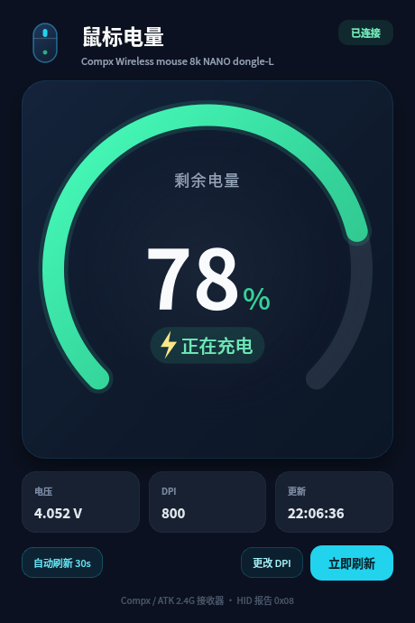
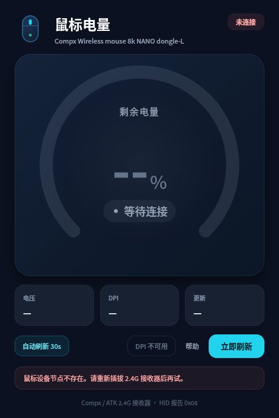

# 鼠标电量（MouseBattery）

[](https://github.com/zhijuyingfeng/MouseBattery/actions/workflows/build.yml)

一个用 **Qt 6 / C++** 写的桌面小工具，用来查看无线鼠标的剩余电量、充电状态和
当前 DPI，并可以修改当前档位的 DPI。
支持 **Linux、Windows、macOS**，界面会显示电池环形进度、充电状态、电压、DPI 和
更新时间，并每 30 秒自动刷新。



## 功能

- 自动发现 Compx / ATK 2.4G 接收器（`373b:11fe`，8K NANO dongle-L）
- 读取剩余电量百分比
- 显示是否正在充电
- 显示电池电压（mV 换算为 V）
- 查看当前 DPI 档位，并通过“更改 DPI”修改当前档位
- 每 30 秒自动刷新，也可以按 **F5** 或点击“立即刷新”
- 读取在后台线程执行，不会卡住界面
- 无设备、无权限、鼠标休眠时给出中文提示
- 深色界面，纯 Qt Widgets，不依赖 QML 或 QtCharts

## 平台支持

| 平台 | HID 访问方式 | 权限 |
| --- | --- | --- |
| Linux | 原生 `/dev/hidraw*` + sysfs | 需要 udev 规则 |
| Windows | hidapi（HID.dll） | 通常不需要管理员权限 |
| macOS | hidapi（IOHIDManager） | 需要“输入监控”权限；分发时需要签名/公证 |

Windows 和 macOS 通过 [hidapi](https://github.com/libusb/hidapi) 访问 HID 接口；
Linux 版本不依赖 hidapi。

## 环境要求

- Qt 6.5 或更新版本（Widgets 模块）
- CMake 3.21+
- 支持 C++20 的编译器
- Windows/macOS 没有系统 hidapi 时，CMake 会通过 `FetchContent` 下载 hidapi 0.14.0，
  因此需要安装 Git 并能够访问 GitHub。也可以提前安装 hidapi，或使用
  `-DFETCHCONTENT_SOURCE_DIR_HIDAPI=/path/to/hidapi` 指向本地源码。

### Linux

```bash
sudo apt install qt6-base-dev cmake g++ git
```

### Windows

推荐使用：

- Windows 10/11 64 位
- Visual Studio 2022（Desktop development with C++）
- Qt 6.8 MSVC 2022 64-bit
- CMake 3.21+
- Git for Windows

### macOS

推荐使用：

- macOS 12 或更新版本
- Xcode Command Line Tools
- Qt 6.8
- CMake 3.21+
- Git

## 构建

### Linux

```bash
cd MouseBattery
cmake -S . -B build -DCMAKE_BUILD_TYPE=Release
cmake --build build -j"$(nproc)"
./build/MouseBattery
```

项目里附带的 `bin/MouseBattery` 是 **Linux x86_64** 预编译版本，可以直接运行：

```bash
./bin/MouseBattery
```

Linux 默认使用原生 hidraw，不需要 hidapi。若要验证 hidapi 后端，可以加
`-DMOUSEBATTERY_USE_HIDAPI=ON`（需要 `libudev-dev`）。

Linux 需要先安装 udev 权限规则：

```bash
sudo ./scripts/install-udev-rule.sh
```

安装后**重新插拔一次 2.4G 接收器**，再启动程序。规则使用 `TAG+="uaccess"`，
只把权限授予当前桌面登录用户，不需要把设备设成 `0666`。

### Windows

在“x64 Native Tools Command Prompt for VS 2022”中执行：

```powershell
cd MouseBattery
cmake -S . -B build -G "Visual Studio 17 2022" -A x64 `
  -DCMAKE_PREFIX_PATH="C:\Qt\6.8.2\msvc2022_64"
cmake --build build --config Release
.\build\Release\MouseBattery.exe
```

如果 Qt 安装在其他目录，把 `CMAKE_PREFIX_PATH` 改成实际路径。
hidapi 会自动下载并静态链接，不需要单独安装驱动，也不需要管理员权限。

发布给其他电脑时，用 `windeployqt` 复制 Qt 运行库：

```powershell
C:\Qt\6.8.2\msvc2022_64\bin\windeployqt.exe `
  .\build\Release\MouseBattery.exe
```

如果只想使用系统/vcpkg 中的 hidapi，可以提前安装，CMake 会优先使用
`find_package(hidapi CONFIG)` 找到的版本。

### macOS

使用 Homebrew Qt：

```bash
brew install qt cmake
cd MouseBattery
cmake -S . -B build -DCMAKE_BUILD_TYPE=Release \
  -DCMAKE_OSX_DEPLOYMENT_TARGET=12.0 \
  -DCMAKE_PREFIX_PATH="$(brew --prefix qt)"
cmake --build build -j"$(sysctl -n hw.ncpu)"
open build/MouseBattery.app
```

如果使用 Qt 官方安装器，把 `CMAKE_PREFIX_PATH` 指向对应的 Qt 目录即可。
构建产物是标准的 `MouseBattery.app` 应用包。

macOS 第一次运行时，如果读不到设备：

1. 打开 **系统设置 → 隐私与安全性 → 输入监控**。
2. 点击 `+`，选择 `MouseBattery.app`，打开开关。
3. 完全退出程序，再重新打开。

Info.plist 已经包含 `NSInputMonitoringUsageDescription`。
本地自签名或未签名构建可能需要右键应用选择“打开”；如果要公开分发，建议使用
Developer ID 签名并做 notarization：

```bash
codesign --deep --force --options runtime \
  --sign "Developer ID Application: Your Name (TEAMID)" \
  build/MouseBattery.app
xcrun notarytool submit ... --wait
```

## 自动打包

仓库包含 [.github/workflows/build.yml](.github/workflows/build.yml)，
在 push 到 `main`、提交 PR 或手动触发 `workflow_dispatch` 时构建三端产物：

| 平台 | 产物 |
| --- | --- |
| Linux x86_64 | `MouseBattery-linux-x86_64.AppImage`、`MouseBattery-linux-x86_64.tar.gz` |
| Windows x86_64 | `MouseBattery-windows-x86_64.zip`（含 Qt DLL） |
| macOS | `MouseBattery-macos.zip`（含 Qt frameworks） |

在 GitHub Actions 运行页面的 **Artifacts** 区域下载。推送 `v*` 标签（例如
`v1.1.0`）时，工作流还会创建一个 GitHub Release 并附带三端压缩包。

Linux AppImage 首次使用仍然需要 udev 规则；可以解压 tar.gz 包后运行
`scripts/install-udev-rule.sh`，或者按上面的说明手动安装。

## 使用

```bash
./build/MouseBattery        # Linux
# 或 build\Release\MouseBattery.exe (Windows)
# 或 open build/MouseBattery.app (macOS)
```

- 启动后会自动读取一次，之后每 30 秒刷新。
- **F5**：立即刷新。
- 左下角按钮可以关闭自动刷新。
- 中间的 DPI 卡片显示当前档位；点击“更改 DPI”输入新值，写入后会重新读取设备确认。
- 鼠标进入休眠后可能暂时读不到数据；动一下鼠标，再点“立即刷新”。

只看界面、不连接鼠标，可以用演示模式：

```bash
./build/MouseBattery --demo
```

Windows：

```powershell
.\build\Release\MouseBattery.exe --demo
```

## 支持的设备

程序会查找满足以下条件的 HID 接口：

- USB 厂商 ID 为 `0x373b`（Compx / ATK）或 `0x3554`（Scyrox / VXE 等）
- Linux：报告描述符中包含 **Report ID 0x08** 和 **16 字节报告**
- Windows/macOS：Usage Page 为 `0xFF02` 或 `0xFF04`；
  对已知的 `0x11fe` / `0x11fd` 接收器，也会按接口 1 兜底匹配

当前使用的接收器是：

```
373b:11fe  Compx Wireless mouse 8k NANO dongle-L
```

这个型号属于 ATK / Compx 的 v1 协议（Usage Page `0xFF02` / `0xFF04`）。
如果以后换用别的 373b 接收器，只要它使用相同的报告 0x08，程序通常也能直接读取。

DPI 使用 ATK v1 的寄存器读写协议。部分固件或型号可能不开放 DPI 寄存器；
如果读取失败，程序会保留电量显示，但将 DPI 显示为“—”并禁用修改按钮。

## 协议说明

程序向接口 1 发送 17 字节的 HID 输出报告：

```
08 04 00 00 00 00 00 00 00 00 00 00 00 00 00 00 49
^  ^                                               ^
|  |                                               checksum
|  battery query command (0x04)
report ID (0x08)
```

校验和的计算方式：17 个字节的 8 位累加和为 `0x55`。
设备返回 17 字节：

| 偏移 | 含义 |
| --- | --- |
| `[0]` | `0x08`，报告 ID |
| `[1]` | `0x04`，电量命令 |
| `[2]` | 状态，`0` 表示成功 |
| `[6]` | 电量百分比（0–100） |
| `[7]` | `1` = 正在充电，`0` = 使用电池 |
| `[8:10]` | 电压，大端序，单位 mV |
| `[16]` | 校验和 |

这个布局与 Compx / ATK v1 协议以及 Pulsar / Scyrox 的公开实现一致。
Linux 通过 hidraw 写出；当接口没有中断 OUT 端点时，内核会自动改用
`SET_REPORT(Output)` 控制传输。Windows/macOS 由 hidapi 处理同样的报告。

### DPI 读取与修改

DPI 使用同一套 16 字节帧（加上 `0x08` 报告 ID）：

- 读命令 `0x08`：读取系统配置地址 `0x0000` 的长度 6 数据，取得档位数量和当前档位；
  再读取 DPI 表地址 `0x000C + 当前档位 × 4` 的 4 字节 DPI word。
- 写命令 `0x07`：向 `0x000C + 当前档位 × 4` 写入 4 字节 DPI word。
- DPI word 包含 X/Y 轴的编码值和校验字节，支持 50–42000 DPI 的范围；
  写入后会立即回读，界面显示设备实际接受的值。
- 只修改当前档位，不会改动其他档位、灯光、按键或回报率。

这部分属于实验性功能：如果设备返回的 DPI 数据校验失败，程序不会发送写命令，
以免误改其他寄存器。

## 常见问题

### Linux 显示“未检测到兼容的鼠标接收器”

```bash
lsusb | grep -i 373b
```

确认接收器已插好。如果 `lsusb` 能看到设备，但没有出现 `/dev/hidraw*`，尝试重新插拔，
或检查内核是否加载了 `usbhid`。

无设备或权限不足时，界面会保留设备名称并显示具体原因：



### Linux 显示“没有访问鼠标 HID 设备的权限”

```bash
ls -l /dev/hidraw*
sudo ./scripts/install-udev-rule.sh
```

安装后重新插拔接收器。可以用 `getfacl /dev/hidraw2` 检查当前用户是否拿到 ACL。

### Windows 找不到设备

- 在“设备管理器 → 人体学输入设备”中确认接收器存在；
- 关闭厂商驱动、网页版驱动或可能独占 HID 的软件；
- 用普通用户运行即可，不需要“以管理员身份运行”；
- 如果提示缺少 Qt DLL，对 exe 运行一次 `windeployqt`。

### macOS 找不到设备或没有权限

- 在 **系统设置 → 隐私与安全性 → 输入监控** 中允许 `MouseBattery.app`；
- 修改权限后必须完全退出并重启应用；
- 移动过 `.app` 或重新构建后，macOS 可能把它当成一个新应用，需要重新授权；
- 如果应用未签名，右键选择“打开”。

### 显示“鼠标没有响应”

- 鼠标可能进入了休眠：动一下鼠标，再点“立即刷新”。
- 关闭可能独占 HID 设备的厂商驱动或网页版驱动工具，再试一次。
- 如果反复超时，可以查看界面上的“最后一次响应”，确认报告是否被其他程序读取。

### 多个接收器同时插入

程序会依次尝试所有匹配的接收器，返回第一个成功响应的设备。

## 目录结构

```
MouseBattery/
├── CMakeLists.txt
├── src/
│   ├── main.cpp                  # 程序入口、字体/主题
│   ├── mainwindow.*              # 主界面
│   ├── batterygauge.*            # 自绘电池环形控件
│   ├── batterydevice.*           # 协议帧、校验和、响应解析
│   ├── batterydevice_linux.cpp   # Linux hidraw 后端
│   ├── batterydevice_hidapi.cpp  # Windows/macOS hidapi 后端
│   └── batteryreader.*           # 后台读取线程对象
├── packaging/Info.plist.in       # macOS 应用包配置
├── tests/protocol_test.cpp       # 协议帧/校验和单元测试
├── udev/                         # Linux 权限规则
├── scripts/                      # udev 安装脚本
├── docs/                         # 界面截图
└── bin/                          # Linux x86_64 预编译文件
```

运行协议测试：

```bash
ctest --test-dir build --output-on-failure
```

## 说明

- 本程序只修改当前档位的 DPI；不会修改灯光、按键、回报率等其他配置。
- 充电状态来自鼠标固件报告；如果鼠标已充满，部分固件可能仍把 `[7]` 报为 `1`，
  此时界面显示“正在充电”代表“已接电源/充电输入”，不一定代表仍在大量充电。
- 如果换用其他品牌/协议的鼠标，需要按该设备的 HID 报告格式调整
  `batterydevice.cpp` 中的命令和偏移。

第三方库（Windows/macOS 使用的 hidapi）的许可证见 [THIRD_PARTY_NOTICES.md](THIRD_PARTY_NOTICES.md)。
